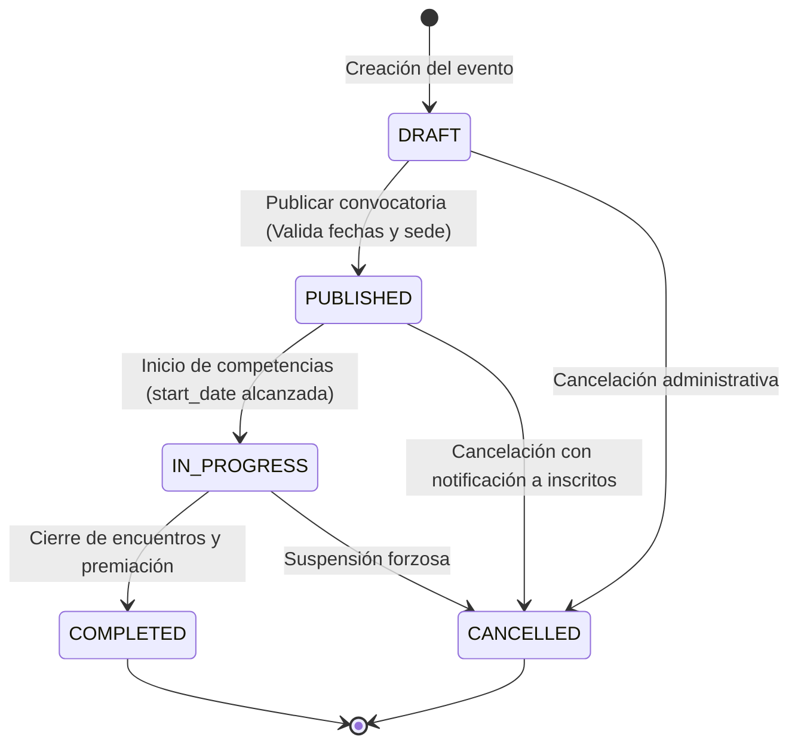

# Funcionalidad: Gestión de Eventos Deportivos (Events Management)

- **ID de Funcionalidad**: FUNC-EVT-MANAGEMENT
- **Capa**: Protected / Secured Application & Infrastructure *(Prevista)*
- **Prefijo de Ruta Proyectado**: `/api/v1/events`
- **Estado Actual de la Funcionalidad**: ⚠️ **PENDIENTE DE IMPLEMENTACIÓN (BACKLOG / ESPECIFICACIÓN FUNCIONAL)**
- **Consumo de datos previsto**: `application/json`
- **Producción de datos prevista**: `application/json`

---

## 1. Diagnóstico de Estado y Hallazgo Arquitectónico

> [!WARNING]
> **Hallazgo de Documentación**: La documentación previa describía operaciones CRUD activas para eventos deportivos bajo `/api/v1/events`. Una auditoría exhaustiva del código fuente del backend (`src/main/java/com/drey/eventsSports/`) determinó que **actualmente no existen controladores (`EventController`), casos de uso, DTOs, entidades JPA ni repositorios implementados para eventos deportivos en el microservicio**.
>
> Invocaciones HTTP hacia `/api/v1/events` en el microservicio en ejecución retornan actualmente **HTTP 404 Not Found** (`ROUTE_NOT_FOUND`) o **HTTP 401 Unauthorized** (interceptadas por la cadena de seguridad).

La base de datos MySQL (`scripts/db/migrations/mysql/000_init.sql`) sí contiene la definición completa del modelo de datos relacional para soportar este módulo en su fase de desarrollo. Este documento describe dicho diseño y los requerimientos funcionales previstos para su posterior implementación.

---

## 2. Modelo Relacional Preparado en Base de Datos

En el esquema de persistencia MySQL (`scripts/db/migrations/mysql/000_init.sql`), la tabla `events` y sus entidades relacionadas ya se encuentran estructuradas:

### 2.1. Estructura de la Tabla `events`

```sql
CREATE TABLE events (
    id BIGINT UNSIGNED NOT NULL AUTO_INCREMENT,
    code VARCHAR(50) NOT NULL,
    name VARCHAR(150) NOT NULL,
    description VARCHAR(1000) NULL,
    organization_id BIGINT UNSIGNED NULL,
    sport_id BIGINT UNSIGNED NOT NULL,
    sport_modality_id BIGINT UNSIGNED NULL,
    competition_type_id BIGINT UNSIGNED NOT NULL,
    event_category_id BIGINT UNSIGNED NULL,
    age_category_id BIGINT UNSIGNED NULL,
    gender_id BIGINT UNSIGNED NULL,
    venue_id BIGINT UNSIGNED NULL,
    start_date DATETIME NOT NULL,
    end_date DATETIME NOT NULL,
    status ENUM('DRAFT', 'PUBLISHED', 'IN_PROGRESS', 'COMPLETED', 'CANCELLED') NOT NULL DEFAULT 'DRAFT',
    created_at DATETIME NOT NULL DEFAULT CURRENT_TIMESTAMP,
    updated_at DATETIME NOT NULL DEFAULT CURRENT_TIMESTAMP ON UPDATE CURRENT_TIMESTAMP,
    deleted_at DATETIME NULL,
    PRIMARY KEY (id),
    UNIQUE KEY uq_events_code (code),
    KEY idx_events_sport (sport_id),
    KEY idx_events_status (status),
    KEY idx_events_dates (start_date, end_date)
) ENGINE=InnoDB;
```

### 2.2. Entidades y Catálogos Relacionados
- **Deportes (`sports`)**: `FOOTBALL`, `BASKETBALL`, `VOLLEYBALL`, `BASEBALL`, `FUTSAL`, `OTHER`.
- **Tipos de Competición (`competition_types`)**: `FREE_TOURNAMENT`, `INTERSCHOOLS`, `CORPORATE_GAMES`, `INSTITUTIONAL`, `MUNICIPAL`, `REGIONAL`, `FEDERATED`, `CUSTOM`.
- **Género / Categoría (`genders`)**: `MALE`, `FEMALE`, `MIXED`.
- **Sedes Deportivas (`sports_venues`)**: Lugares e instalaciones donde se disputan los encuentros.
- **Fases del Evento (`event_phases`)**: Estructuración del torneo (grupos, eliminación directa, finales).
- **Reglas del Evento (`event_rules` / `event_rule_values`)**: Parámetros de inscripción, límites de edad, integrantes por equipo y documentación exigida.

---

## 3. Matriz de Ciclo de Vida y Estados del Evento (Previsto)

Los eventos deportivos contarán con una máquina de estados controlada basada en el enum relacional:



| Estado | Significado Funcional | Operaciones Permitidas |
| :--- | :--- | :--- |
| `DRAFT` | Evento en borrador o configuración inicial | Edición completa de datos, fechas y reglas. Eliminación lógica permitida. |
| `PUBLISHED` | Convocatoria pública y período de inscripciones abierto | Inscripción de equipos y participantes. Modificación restringida de fechas. |
| `IN_PROGRESS` | Competencia en desarrollo | Registro de partidos, resultados y planillas oficiales. No permite cambios de sede ni estructura. |
| `COMPLETED` | Competencia finalizada | Solo lectura para consulta histórica y auditoría. |
| `CANCELLED` | Evento suspendido o anulado | Inmutable, no permite inscripciones ni partidos adicionales. |

---

## 4. Especificación de Endpoints Proyectados (Diseño Futuro)

Cuando se implemente el módulo de eventos en la capa de adaptadores y aplicación, deberá seguir las convenciones de diseño hexagonal y los siguientes contratos funcionales:

### 4.1. Resumen de Endpoints Previstos

| Operación Proyectada | Método HTTP | Ruta Propuesta | Rol / Permiso Previsto | Estado |
| :--- | :--- | :--- | :--- | :--- |
| **Listar Eventos Paginados** | `GET` | `/api/v1/events` | Autenticado (`USERS_READ` o público con filtro) | ❌ Pendiente de Implementación |
| **Consultar Detalle de Evento** | `GET` | `/api/v1/events/{id}` | Autenticado | ❌ Pendiente de Implementación |
| **Crear Evento Deportivo** | `POST` | `/api/v1/events` | Authority `EVENTS_CREATE` / Rol `ADMIN` | ❌ Pendiente de Implementación |
| **Actualizar Evento Deportivo** | `PUT` | `/api/v1/events/{id}` | Authority `EVENTS_UPDATE` / Rol `ADMIN` | ❌ Pendiente de Implementación |
| **Cambiar Estado de Evento** | `PATCH` | `/api/v1/events/{id}/status` | Authority `EVENTS_STATUS_CHANGE` | ❌ Pendiente de Implementación |
| **Eliminar Evento (Soft Delete)** | `DELETE` | `/api/v1/events/{id}` | Authority `EVENTS_DELETE` / Rol `ADMIN` | ❌ Pendiente de Implementación |

---

### 4.2. Contrato de Entrada Proyectado para Creación (`POST /api/v1/events`)

#### Encabezados Requeridos
```http
Authorization: Bearer <token_jwt>
Content-Type: application/json
Accept: application/json
```

#### Estructura del Cuerpo Propuesto (Payload)
Alineado con los nombres de campos de la base de datos real:

```json
{
  "code": "TORNEO-FUT-2026",
  "name": "Torneo Apertura de Fútbol 2026",
  "description": "Campeonato aficionado categoría libre para clubes locales",
  "organizationId": 1,
  "sportId": 1,
  "sportModalityId": 1,
  "competitionTypeId": 1,
  "eventCategoryId": 1,
  "ageCategoryId": 1,
  "genderId": 1,
  "venueId": 1,
  "startDate": "2026-10-15T09:00:00",
  "endDate": "2026-10-20T18:00:00"
}
```

#### Validaciones de Negocio a Implementar:
1. `code`: obligatorio, único en la base de datos (`uq_events_code`).
2. `name`: obligatorio, longitud entre 3 y 150 caracteres.
3. `sportId`: obligatorio, debe existir en el catálogo `sports`.
4. `competitionTypeId`: obligatorio, debe existir en el catálogo `competition_types`.
5. `startDate` y `endDate`: obligatorias. Se debe validar estrictamente que `startDate < endDate` y que `startDate` no sea anterior a la fecha actual.
6. `venueId`: si se suministra, debe existir en `sports_venues` y no presentar conflictos de disponibilidad en `venue_availability`.

---

### 4.3. Respuesta Exitosa Proyectada (HTTP 201 Created)

Siguiendo el estándar `ApiResponse<T>`:

```json
{
  "success": true,
  "status": "success",
  "message": "Event created successfully",
  "data": {
    "id": 1,
    "code": "TORNEO-FUT-2026",
    "name": "Torneo Apertura de Fútbol 2026",
    "description": "Campeonato aficionado categoría libre para clubes locales",
    "sport": {
      "id": 1,
      "code": "FOOTBALL",
      "name": "Football"
    },
    "competitionType": {
      "id": 1,
      "code": "FREE_TOURNAMENT",
      "name": "Free Tournament"
    },
    "status": "DRAFT",
    "startDate": "2026-10-15T09:00:00",
    "endDate": "2026-10-20T18:00:00",
    "createdAt": "2026-10-10T10:00:00Z",
    "updatedAt": "2026-10-10T10:00:00Z"
  },
  "timestamp": "2026-10-10T10:00:00Z",
  "requestId": "f2a3b4c5-d6e7-8f9a-0b1c-2d3e4f5a6b7c"
}
```

---

## 5. Tareas Pendientes para la Implementación (Roadmap)

Para materializar este módulo en el backend, se requerirá desarrollar:

1. **Capa de Dominio (`domain/`)**:
   - Entidad de dominio `Event` y value objects de fechas y estados.
   - Puertos de salida `EventRepositoryPort` y `CatalogRepositoryPort`.
   - Puertos de entrada `CreateEventUseCase`, `GetEventUseCase`, `ListEventsUseCase`, `UpdateEventUseCase`, `DeleteEventUseCase`.
2. **Capa de Aplicación (`application/`)**:
   - Casos de uso e implementaciones con validaciones de fechas y reglas de negocio.
   - DTOs de entrada y salida (`CreateEventRequest`, `UpdateEventRequest`, `EventResponse`).
3. **Capa de Infraestructura (`infrastructure/`)**:
   - Adaptador de persistencia JPA `EventJpaEntity` y `SpringDataEventRepository`.
   - Controlador asegurado `EventController` bajo `@RequestMapping("/api/v1/events")` con validación de seguridad `@PreAuthorize`.
4. **Seguridad y Permisos**:
   - Sembrado en base de datos de los permisos granulares: `EVENTS_CREATE`, `EVENTS_READ`, `EVENTS_UPDATE`, `EVENTS_DELETE`.
   - Asignación de permisos al rol `ADMIN` en `role_permissions`.

---

## 6. Referencias Cruzadas
- [Seguridad y Autenticación JWT](./jwt_authentication_and_security.md)
- [Gestión de Usuarios](./users_management.md)
- [Esquema de Migración Inicial MySQL (000_init.sql)](file:///d:/proyecto/src/back/api_events_sports/scripts/db/migrations/mysql/000_init.sql)
- [Códigos de Error de la API](../../02_api/codigos-error.md)
