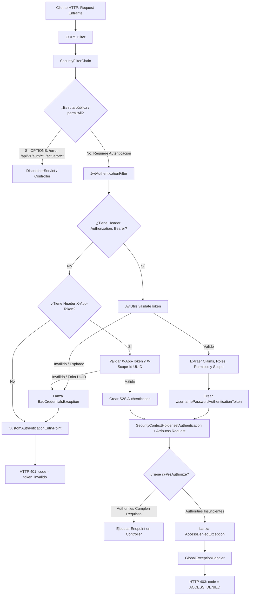
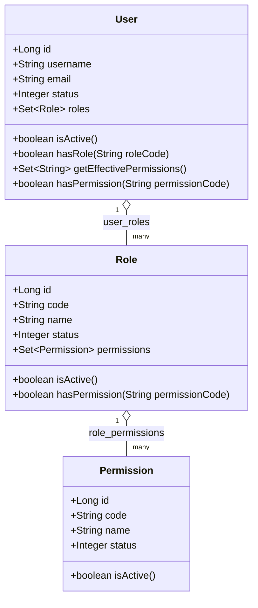

# Funcionalidad: Seguridad y Autenticación JWT (Security & Authorization)

- **ID de Funcionalidad**: FUNC-SEC-JWT
- **Capa**: Protected / Security Infrastructure / Filter Chain / Application Adapters
- **Alcance**: Todos los endpoints de la API REST bajo `/api/v1/**` (excluyendo rutas explícitamente públicas)
- **Mecanismos de Autenticación Implementados**:
  1. **HTTP Bearer JWT (RFC 7519)**: Para usuarios y administradores autenticados.
  2. **Service-to-Service (S2S) App Token**: Para comunicación autenticada entre microservicios del ecosistema mediante `X-App-Token` y `X-Scope-Id`.
- **Librerías Base**: Spring Security 6.4.3, JJWT 0.12.6, BCrypt (Spring Security Crypto)

---

## 1. Descripción y Arquitectura de Seguridad

El microservicio `api_events_sports` opera bajo un modelo de seguridad **Stateless** (sin estado de sesión en servidor ni cookies `JSESSIONID`), delegando la verificación de identidad y privilegios en tokens criptográficos autofirmados y autocontenidos.

La arquitectura de seguridad está compuesta por los siguientes componentes clave:
- [`SecurityConfig`](file:///d:/proyecto/src/back/api_events_sports/src/main/java/com/drey/eventsSports/infrastructure/config/SecurityConfig.java): Define la cadena de filtros de seguridad (`SecurityFilterChain`), la política de sesiones stateless, la configuración CORS, la desactivación de CSRF y la asignación de permisos por patrón de ruta.
- [`JwtAuthenticationFilter`](file:///d:/proyecto/src/back/api_events_sports/src/main/java/com/drey/eventsSports/infrastructure/config/JwtAuthenticationFilter.java): Filtro de tipo `OncePerRequestFilter` que intercepta cada solicitud entrante, extrae el token Bearer o los encabezados S2S, valida su autenticidad y establece la autenticación en el `SecurityContextHolder`.
- [`JwtUtils`](file:///d:/proyecto/src/back/api_events_sports/src/main/java/com/drey/eventsSports/shared/utils/JwtUtils.java): Utilidad central para la generación, firmado HS256, parseo y extracción de claims y authorities de los tokens JWT.
- [`JwtTokenProviderAdapter`](file:///d:/proyecto/src/back/api_events_sports/src/main/java/com/drey/eventsSports/infrastructure/security/JwtTokenProviderAdapter.java): Adaptador de salida que implementa el puerto `TokenProviderPort`, traduciendo entidades del dominio a tokens firmados.
- [`CustomAuthenticationEntryPoint`](file:///d:/proyecto/src/back/api_events_sports/src/main/java/com/drey/eventsSports/infrastructure/config/CustomAuthenticationEntryPoint.java): Punto de entrada para fallos de autenticación (solicitudes sin token, token expirado o firma inválida), asegurando respuestas de error uniformes en formato JSON con código HTTP 401.

### Flujo de Intercepción y Autenticación en la Cadena de Filtros



---

## 2. Validación de Tokens y Autenticación de Solicitudes

### 2.1. Autenticación mediante JWT Bearer

Para acceder a endpoints protegidos, el cliente debe proveer el token en la cabecera estándar `Authorization`:

```http
Authorization: Bearer <token_jwt>
```

#### Proceso de Validación y Extracción:
1. **Extracción**: El filtro [`JwtAuthenticationFilter`](file:///d:/proyecto/src/back/api_events_sports/src/main/java/com/drey/eventsSports/infrastructure/config/JwtAuthenticationFilter.java) detecta el encabezado `Authorization` con prefijo `Bearer `.
2. **Validación de Firma y Expiración**: Se invoca `jwtUtils.validateToken(token)`. El método utiliza el parser criptográfico JJWT configurado con la clave simétrica `SecretKey` derivada de `app.security.jwt.secret`. Si el token ha expirado, está malformado o la firma digital no coincide, lanza `BadCredentialsException("Invalid JWT token")`.
3. **Construcción del Principal**:
   - `userId`: obtenido del claim `sub` (`jwtUtils.getUserIdFromToken(token)`).
   - `email`: obtenido del claim `email` (`jwtUtils.getEmailFromToken(token)`).
   - Principal asignado: `email != null ? email : userId`.
4. **Mapeo de Autoridades (`GrantedAuthority`)**:
   `jwtUtils.getAuthoritiesFromToken(token)` transforma tanto roles como permisos en autoridades de Spring Security:
   - Para cada rol en el claim `roles`:
     - Se agrega la autoridad exacta del rol: `role` (ej. `"ADMIN"`).
     - Si no empieza con `"ROLE_"`, se agrega también con prefijo: `"ROLE_" + role` (ej. `"ROLE_ADMIN"`).
   - Para cada permiso en el claim `permissions`:
     - Se agrega la autoridad exacta del permiso: `permission` (ej. `"USERS_CREATE"`).
     - Si no empieza con `"PERMISSION_"`, se agrega también con prefijo: `"PERMISSION_" + permission` (ej. `"PERMISSION_USERS_CREATE"`).
5. **Inyección en el Contexto**: Se crea un `UsernamePasswordAuthenticationToken(principal, null, authorities)` y se fija en `SecurityContextHolder.getContext().setAuthentication(authentication)`.
6. **Atributos de Request**: Se adjuntan al `HttpServletRequest` los atributos de trazabilidad:
   - `request.setAttribute("user_id", userId)`
   - `request.setAttribute("email", email)`
   - `request.setAttribute("auth_method", "jwt")`
   - `request.setAttribute("scope_id", scopeId)`

---

### 2.2. Autenticación Alternativa Service-to-Service (S2S)

El filtro incluye soporte nativo para invocaciones autenticadas entre microservicios del backend (sin token de usuario) mediante tokens de aplicación:

- **Encabezado de Token**: `X-App-Token` (propiedad configurable: `app.security.app-token-header`).
- **Encabezado de Alcance**: `X-Scope-Id` (propiedad configurable: `app.security.app-scope-header`).
- **Clave Esperada**: Configurada en `app.security.app-token`.

#### Validación:
- Se realiza una comparación en tiempo constante contra ataques de canal lateral (timing attacks):
  ```java
  MessageDigest.isEqual(appHeaderBytes, appTokenBytes)
  ```
- Se exige obligatoriamente un identificador de ámbito (`X-Scope-Id`) que debe ser un formato UUID válido.
- En caso de éxito, se establece un `UsernamePasswordAuthenticationToken` con `principal = scopeId.toString()`, lista de autoridades vacía, y atributo `auth_method: "app_token"`.

---

### 2.3. Delimitación de Rutas Públicas vs. Protegidas

Conforme a la configuración en [`SecurityConfig`](file:///d:/proyecto/src/back/api_events_sports/src/main/java/com/drey/eventsSports/infrastructure/config/SecurityConfig.java):

| Categoría | Patrón de Ruta | Requisito de Acceso | Justificación |
| :--- | :--- | :--- | :--- |
| **Preflight** | `OPTIONS /**` | `permitAll()` | Negociación CORS desde clientes de navegador |
| **Error Handling** | `/error` | `permitAll()` | Delegación hacia `CustomErrorController` de Spring |
| **Autenticación** | `/api/v1/auth/**` | `permitAll()` | Login anónimo e inicio de sesión |
| **Mensajería Anónima**| `/api/v1/messaging/anonymous/**` | `permitAll()` | Recepción de notificaciones o webhooks públicos |
| **Monitoreo** | `/actuator/**` | `permitAll()` | Probes de liveness/readiness, métricas y estado del servicio |
| **Protegidas (API)** | `/api/v1/**` | `authenticated()` | Requiere JWT válido o S2S Token |
| **Cualquier otra** | `anyRequest()` | `authenticated()` | Política de seguridad por defecto: denegar por omisión |

---

## 3. Estructura y Claims del Token JWT

El token generado en el login utiliza el algoritmo criptográfico simétrico **HMAC-SHA256 (`HS256`)**.

### 3.1. Anatomía Real del Payload de Claims
Los claims emitidos por [`JwtUtils.generateToken`](file:///d:/proyecto/src/back/api_events_sports/src/main/java/com/drey/eventsSports/shared/utils/JwtUtils.java) corresponden a la siguiente estructura:

```json
{
  "sub": "1",
  "email": "admin@sportsevents.com",
  "username": "admin",
  "roles": [
    "ADMIN"
  ],
  "role": "ADMIN",
  "permissions": [
    "USERS_CREATE",
    "USERS_READ"
  ],
  "authorization": {
    "roles": [
      "ADMIN"
    ],
    "permissions": [
      "USERS_CREATE",
      "USERS_READ"
    ],
    "role": "ADMIN"
  },
  "scope_id": "9b1deb4d-3b7d-4bad-9bdd-2b0d7b3dcb6d",
  "iat": 1789226264,
  "exp": 1789312664
}
```

> **Aviso de Seguridad**: La estructura anterior es una representación técnica ilustrativa generada a partir de los campos del código fuente. Nunca expone secretos de firma ni credenciales reales en producción.

### 3.2. Catálogo Detallado de Claims

| Claim | Tipo | Origen en Dominio | Propósito Funcional |
| :--- | :--- | :--- | :--- |
| `sub` | `String` | `user.getId()` | Identificador numérico del usuario (Subject principal). |
| `email` | `String` | `user.getEmail()` | Correo electrónico verificado del usuario. |
| `username` | `String` | `user.getUsername()` | Nombre de usuario o identificador de acceso. |
| `roles` | `List<String>` | `Role::getCode` | Lista de códigos de rol activos asignados al usuario en `user_roles`. |
| `role` | `String` | `roles.get(0)` | Rol primario del usuario para compatibilidad con consumidores mono-rol. |
| `permissions` | `List<String>` | `user.getEffectivePermissions()` | Lista de códigos de permiso atómicos calculados a partir de los roles activos. |
| `authorization` | `Object` | Objeto anidado | Agrupador estructurado con `roles`, `permissions` y `role` para clientes frontend y gateways. |
| `scope_id` | `String` | `UUID.randomUUID()` | Identificador único de sesión o contexto de emisión para correlación y segmentación. |
| `iat` | `NumericDate`| Timestamp actual | Fecha/hora de emisión del token en formato Unix Epoch (segundos). |
| `exp` | `NumericDate`| Timestamp + vigencia | Fecha/hora de expiración del token en formato Unix Epoch (segundos). |

---

## 4. Parámetros de Configuración y Ciclo de Vida del Token

Los parámetros de seguridad JWT se definen en [`application.yml`](file:///d:/proyecto/src/back/api_events_sports/src/main/resources/application.yml) bajo el prefijo `app.security.jwt`:

```yaml
app:
  security:
    jwt:
      secret: ${JWT_SECRET:3cfa76ef14937c1c0ea519f8fc057a80fcd04a74ac2b9bd91000223f108f3e58}
      expiration: ${JWT_EXPIRATION:86400} # Expiración en segundos (86400 s = 24 horas)
```

Los parámetros del mecanismo S2S (Service-to-Service) **no están declarados en `application.yml`**; se configuran directamente como valores por defecto en las anotaciones `@Value` del filtro [`JwtAuthenticationFilter`](file:///d:/proyecto/src/back/api_events_sports/src/main/java/com/drey/eventsSports/infrastructure/config/JwtAuthenticationFilter.java):

```java
@Value("${app.security.app-token:}")          // Token de aplicación (vacío por defecto = deshabilitado)
private String appToken;

@Value("${app.security.app-token-header:X-App-Token}")  // Nombre del header S2S
private String appTokenHeader;

@Value("${app.security.app-scope-header:X-Scope-Id}")   // Nombre del header de scope
private String appScopeHeader;
```

Para habilitar la autenticación S2S en un entorno, basta con definir la variable de entorno `APP_SECURITY_TOKEN` con un valor no vacío.

### Reglas de Configuración:
- **Expiración (`expiration`)**: La unidad de configuración en `JwtUtils` es en **segundos**. El valor predeterminado es `86400` segundos (24 horas).
- **Clave Secreta (`secret`)**: Clave en texto plano convertida a bytes UTF-8. [`JwtUtils`](file:///d:/proyecto/src/back/api_events_sports/src/main/java/com/drey/eventsSports/shared/utils/JwtUtils.java) verifica que si la longitud de la clave es menor a 32 bytes (256 bits requeridos por HMAC-SHA256), se aplica un padding automático a 32 bytes para prevenir excepciones criptográficas al inicializar `Keys.hmacShaKeyFor`.

---

## 5. Modelo de Autorización: Usuarios, Roles y Permisos

El sistema implementa una combinación de **Control de Acceso Basado en Roles (RBAC)** y **Control de Acceso Basado en Permisos (PBAC)**.



### 5.1. Distinción entre Autenticación y Autorización
- **Autenticación (Identidad)**: Responde a la pregunta *"¿Quién es el usuario?"*. Se determina al verificar el JWT o las credenciales contra `users`.
- **Autorización (Privilegio)**: Responde a la pregunta *"¿Qué acciones puede realizar este usuario en el recurso?"*. Se determina mediante los permisos efectivos calculados en la entidad `User`.

### 5.2. Relación y Herencia de Permisos
1. Los permisos **no** se asignan directamente al usuario. Se asignan a **Roles**.
2. Un usuario posee uno o más roles vinculados en la tabla relacional `user_roles`.
3. Un rol posee uno o más permisos vinculados en la tabla relacional `role_permissions`.
4. **Cálculo de Permisos Efectivos (`getEffectivePermissions`)**:
   El método en la entidad de dominio `User` evalúa:
   - Solo los roles con `Role::isActive` (`status == 1`).
   - Dentro de cada rol activo, solo los permisos con `Permission::isActive` (`status == 1`).
   - Retorna la unión de todos los códigos de permiso activos en un `Set<String>`.

### 5.3. Catálogo de Roles Sembrados (Catálogo Inicial)

| Rol (`code`) | Nombre | Propósito |
| :--- | :--- | :--- |
| `ADMIN` | Administrator | Administración completa de la plataforma |
| `OPERATOR` | Operator | Gestión operativa de eventos y registros |
| `AUDITOR` | Auditor | Acceso de solo lectura para auditoría y trazabilidad |

### 5.4. Catálogo de Permisos Sembrados

| Permiso (`code`) | Nombre | Roles Asignados Inicialmente | Propósito |
| :--- | :--- | :--- | :--- |
| `USERS_CREATE` | Create Users | `ADMIN` | Autoriza la creación de usuarios en el sistema |
| `USERS_READ` | Read Users | `ADMIN` | Autoriza la consulta de información de usuarios |

### 5.5. Evaluación en Controladores
Para proteger endpoints, se utiliza la anotación de Spring Security `@EnableMethodSecurity`:
```java
@PostMapping({"/users", ""})
@PreAuthorize("hasAuthority('USERS_CREATE')")
public ResponseEntity<ApiResponse<UserResponse>> createUser(...) { ... }
```
Al inyectar tanto `USERS_CREATE` como `PERMISSION_USERS_CREATE` en las autoridades del token, el sistema soporta sintaxis de autoridad estándar `hasAuthority('USERS_CREATE')` o de rol `hasRole('ADMIN')`.

---

## 6. Respuestas de Error de Seguridad

El microservicio utiliza un formato unificado de error JSON gestionado por [`CustomAuthenticationEntryPoint`](file:///d:/proyecto/src/back/api_events_sports/src/main/java/com/drey/eventsSports/infrastructure/config/CustomAuthenticationEntryPoint.java) y [`GlobalExceptionHandler`](file:///d:/proyecto/src/back/api_events_sports/src/main/java/com/drey/eventsSports/infrastructure/controllers/GlobalExceptionHandler.java).

### 6.1. HTTP 401 Unauthorized: Token Inválido o Ausente
Disparado cuando una petición a un endpoint protegido no incluye token, el token ha expirado o la firma digital no es válida:

```json
{
  "status": "error",
  "error": {
    "code": "token_invalido",
    "details": "Full authentication is required to access this resource"
  },
  "timestamp": "2026-09-12T10:11:00Z",
  "requestId": "2fa99008-8e6c-486a-8b89-a35208b078a6"
}
```

### 6.2. HTTP 401 Unauthorized: Cuenta Inactiva
Disparado en el login si el usuario existe pero tiene `status != 1`:

```json
{
  "status": "error",
  "error": {
    "code": "USER_INACTIVE",
    "details": "Account is inactive"
  },
  "timestamp": "2026-09-12T10:11:00Z",
  "requestId": "a7b8c9d0-e1f2-3a4b-5c6d-7e8f9a0b1c2d"
}
```

### 6.3. HTTP 403 Forbidden: Autoridad / Permiso Insuficiente
Disparado cuando el usuario posee un token válido pero carece del authority requerido por `@PreAuthorize` (ej. carece de `USERS_CREATE`):

```json
{
  "status": "error",
  "error": {
    "code": "ACCESS_DENIED",
    "details": "Access Denied"
  },
  "timestamp": "2026-09-12T10:11:00Z",
  "requestId": "b4c5d6e7-f8a9-0b1c-2d3e-4f5a6b7c8d9e"
}
```

### 6.4. HTTP 403 Forbidden: Privilegios de Rol Insuficientes en Login
Disparado si un usuario intenta autenticarse mediante login administrativo pero carece del rol `ADMIN`:

```json
{
  "status": "error",
  "error": {
    "code": "FORBIDDEN_ROLE",
    "details": "User does not have required administrator privileges"
  },
  "timestamp": "2026-09-12T10:11:00Z",
  "requestId": "6b7c8d9e-0f1a-2b3c-4d5e-6f7a8b9c0d1e"
}
```

---

## 7. Política CORS (Cross-Origin Resource Sharing)

Configurada de forma explícita en [`SecurityConfig.corsConfigurationSource`](file:///d:/proyecto/src/back/api_events_sports/src/main/java/com/drey/eventsSports/infrastructure/config/SecurityConfig.java):

- **Orígenes Permitidos (`allowedOriginPatterns`)**: `*` (patrón universal compatible con credenciales).
- **Métodos HTTP Permitidos**: `GET`, `POST`, `PUT`, `DELETE`, `OPTIONS`, `PATCH`.
- **Encabezados Permitidos (`allowedHeaders`)**: `*`.
- **Soporte de Credenciales (`allowCredentials`)**: `true`.
- **Encabezados Expuestos (`exposedHeaders`)**: `Authorization`.
- **Preflight**: Las peticiones `OPTIONS /**` están explícitamente permitidas (`permitAll()`) y no pasan por la validación de tokens.

---

## 8. Consideraciones de Seguridad Implementadas vs. Recomendaciones

### Medidas Efectivamente Implementadas:
- [x] **Cifrado de contraseñas con BCrypt**: Con factor de costo 10 implementado en `BcryptPasswordEncoderAdapter`.
- [x] **Filtro OncePerRequestFilter**: Evita ejecuciones redundantes de validación por cada solicitud HTTP.
- [x] **Protección contra fugas de hash**: Ningún DTO expone contraseñas o campos de hash de contraseñas.
- [x] **Comparación temporalmente constante en S2S**: Prevención de ataques de temporización en la validación de `app-token`.
- [x] **Verificación de estado de cuenta**: Usuarios inactivos son rechazados de inmediato.

### Consideraciones y Recomendaciones Futuras:
- **Lista de revocación de tokens (Blacklisting)**: Al ser un mecanismo puramente stateless, los tokens emitidos permanecen válidos hasta su expiración (`exp`), salvo que se incorpore un mecanismo de revocación basado en Redis o invalidación de tokens.
- **Refresh Tokens**: Actualmente el backend implementa únicamente access tokens de 24 horas; la rotación automática mediante refresh tokens se encuentra prevista para futuras fases.

---

## 9. Referencias Cruzadas
- [Gestión de Usuarios](./users_management.md)
- [Autenticación de Administrador (Login)](../anonymous/authentication.md)
- [Códigos de Error de la API](../../02_api/codigos-error.md)
