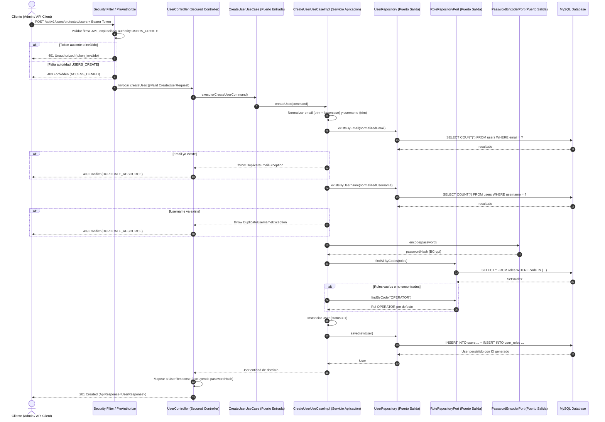

# Funcionalidad: Gestión de Usuarios (Users Management)

- **ID de Funcionalidad**: FUNC-USR-MANAGEMENT
- **Capa**: Protected / Secured Controllers / Hexagonal Domain
- **Prefijos de Ruta Configurados**:
  - Base canónica protegida: `/api/v1/users/protected`
  - Alias directo: `/api/v1/users`
- **Autenticación requerida**: `Bearer <JWT>` (Obligatorio)
- **Autorización requerida**: Authority `USERS_CREATE` (o `PERMISSION_USERS_CREATE`)
- **Consumo de datos**: `application/json`
- **Producción de datos**: `application/json`

---

## 1. Objetivo y Alcance Funcional

Permite a los clientes autenticados con privilegios administrativos registrar nuevos usuarios dentro de la plataforma de eventos deportivos (`api_events_sports`).

La funcionalidad garantiza:
- **Control de Acceso Basado en Permisos (PBAC)**: Exige la autoridad granular `USERS_CREATE` mediante la anotación de seguridad de Spring `@PreAuthorize("hasAuthority('USERS_CREATE')")`.
- **Integridad y Unicidad**: Impide la duplicidad de cuentas mediante validación explícita de correo electrónico (`email`) y nombre de usuario (`username`).
- **Seguridad Criptográfica**: Las contraseñas se almacenan cifradas utilizando el algoritmo BCrypt con factor de costo 10 mediante el puerto `PasswordEncoderPort`.
- **Confidencialidad Estricta**: Ni la contraseña en texto plano ni el hash criptográfico (`passwordHash`) son expuestos en los contratos de respuesta (`UserResponse`, `UserDto`), registros de auditoría o trazas de error.
- **Asignación de Roles**: Vinculación de roles relacionales (`ADMIN`, `OPERATOR`, `AUDITOR`) resolviendo contra catálogo persistido, con asignación por defecto a `OPERATOR` si no se especifican.

> **Alcance de la Implementación Actual**: En el microservicio actual, la única operación implementada para la gestión de usuarios es la **Creación de Usuarios** (`POST`). Las operaciones de consulta (`GET /api/v1/users/me`, `GET /api/v1/users/{id}`, `GET /api/v1/users`), actualización (`PUT`), modificación de estado y eliminación (`DELETE`) no están implementadas en el código fuente actual y se detallan en la sección de [Operaciones No Implementadas (Backlog)](#8-operaciones-no-implementadas-backlog).

---

## 2. Endpoints Implementados

La clase controladora [`UserController`](file:///d:/proyecto/src/back/api_events_sports/src/main/java/com/drey/eventsSports/infrastructure/controllers/secured/UserController.java) registra los siguientes mapeos HTTP:

| Método | Ruta | Propósito | Autorización Exigida |
| :--- | :--- | :--- | :--- |
| `POST` | `/api/v1/users/protected/users` | Creación de nuevo usuario (Ruta canónica protegida) | Authority `USERS_CREATE` |
| `POST` | `/api/v1/users/protected` | Creación de nuevo usuario (Alias sobre sub-ruta) | Authority `USERS_CREATE` |
| `POST` | `/api/v1/users` | Creación de nuevo usuario (Alias sobre prefijo base) | Authority `USERS_CREATE` |
| `POST` | `/api/v1/users/users` | Creación de nuevo usuario (Alias compatible) | Authority `USERS_CREATE` |

---

## 3. Requisitos de Autenticación y Autorización

### 3.1. Encabezados de Seguridad
Toda solicitud hacia los endpoints de gestión de usuarios debe incluir un token JWT emitido por el servicio de autenticación:

```http
Authorization: Bearer <jwt_token>
Content-Type: application/json
Accept: application/json
```

### 3.2. Reglas de Autorización
1. El filtro [`JwtAuthenticationFilter`](file:///d:/proyecto/src/back/api_events_sports/src/main/java/com/drey/eventsSports/infrastructure/config/JwtAuthenticationFilter.java) valida la firma digital HS256 y la vigencia temporal del token.
2. [`JwtUtils`](file:///d:/proyecto/src/back/api_events_sports/src/main/java/com/drey/eventsSports/shared/utils/JwtUtils.java) extrae los permisos del claim `permissions` (y del objeto anidado `authorization.permissions`), inyectando en el `SecurityContext` las autoridades correspondientes (ej. `USERS_CREATE` y `PERMISSION_USERS_CREATE`).
3. La anotación `@PreAuthorize("hasAuthority('USERS_CREATE')")` en el método `createUser` valida que el usuario autenticado posea dicha autoridad.
4. Si el token no se suministra o es inválido/expirado, [`CustomAuthenticationEntryPoint`](file:///d:/proyecto/src/back/api_events_sports/src/main/java/com/drey/eventsSports/infrastructure/config/CustomAuthenticationEntryPoint.java) intercepta la petición retornando HTTP 401 con código `token_invalido`.
5. Si el usuario está autenticado pero su token no contiene el permiso `USERS_CREATE`, [`GlobalExceptionHandler`](file:///d:/proyecto/src/back/api_events_sports/src/main/java/com/drey/eventsSports/infrastructure/controllers/GlobalExceptionHandler.java) captura `AccessDeniedException` y retorna HTTP 403 con código `ACCESS_DENIED`.

---

## 4. Arquitectura Hexagonal y Flujo de Ejecución

El proceso de creación de usuario sigue estrictamente el aislamiento por capas de la arquitectura hexagonal:



---

## 5. Contrato de Entrada (Request Contract)

### 5.1. Estructura JSON del Cuerpo de la Petición
Representado por el DTO [`CreateUserRequest`](file:///d:/proyecto/src/back/api_events_sports/src/main/java/com/drey/eventsSports/application/dtos/CreateUserRequest.java):

```json
{
  "username": "carlos_gomez",
  "email": "carlos.gomez@sportsevents.com",
  "password": "Password123+",
  "firstName": "Carlos",
  "lastName": "Gómez",
  "phone": "+573001112233",
  "roles": [
    "OPERATOR"
  ]
}
```

### 5.2. Reglas de Validación de Entrada (Bean Validation)

| Campo | Tipo | Obligatorio | Restricciones de Validación | Mensaje de Error en Falla |
| :--- | :--- | :--- | :--- | :--- |
| `username` | `String` | **Sí** | `@NotBlank`, `@Size(min = 3, max = 100)` | `"Username is required"` / `"Username must be between 3 and 100 characters"` |
| `email` | `String` | **Sí** | `@NotBlank`, `@Email` | `"Email is required"` / `"Email must be a valid email address"` |
| `password` | `String` | **Sí** | `@NotBlank`, `@Size(min = 6, max = 100)` | `"Password is required"` / `"Password must be at least 6 characters"` |
| `firstName` | `String` | **Sí** | `@NotBlank`, `@Size(max = 100)` | `"First name is required"` / `"First name cannot exceed 100 characters"` |
| `lastName` | `String` | **Sí** | `@NotBlank`, `@Size(max = 150)` | `"Last name is required"` / `"Last name cannot exceed 150 characters"` |
| `phone` | `String` | No | Opcional, `@Size(max = 50)` | `"Phone cannot exceed 50 characters"` |
| `roles` | `Set<String>`| No | Opcional. Códigos de rol en catálogo (ej. `OPERATOR`, `ADMIN`, `AUDITOR`) | Si no se envía o está vacío, se asigna `OPERATOR` por defecto |

---

## 6. Reglas de Negocio

El caso de uso [`CreateUserUseCaseImpl`](file:///d:/proyecto/src/back/api_events_sports/src/main/java/com/drey/eventsSports/application/usecases/CreateUserUseCaseImpl.java) ejecuta la siguiente lógica de negocio:

1. **Inmutabilidad y Nulidad del Comando**:
   - Si `command == null`, se lanza `IllegalArgumentException("CreateUserCommand cannot be null")`.
2. **Normalización y Sanitización de Cadenas**:
   - `email`: se aplica `trim().toLowerCase()`.
   - `username`, `firstName`, `lastName`: se aplica `trim()`.
   - `phone`: se aplica `trim()` únicamente si el valor no es nulo.
3. **Validación de Unicidad de Correo Electrónico**:
   - Se consulta `userRepository.existsByEmail(normalizedEmail)`.
   - Si el correo ya existe, se interrumpe el flujo y se lanza `DuplicateEmailException("User with email '<email>' already exists")`.
4. **Validación de Unicidad de Nombre de Usuario**:
   - Se consulta `userRepository.existsByUsername(normalizedUsername)`.
   - Si el nombre de usuario ya existe, se lanza `DuplicateUsernameException("User with username '<username>' already exists")`.
5. **Cifrado de Contraseña**:
   - La contraseña en texto plano se procesa mediante `passwordEncoder.encode(command.password())` generando un hash seguro BCrypt.
6. **Resolución de Roles**:
   - Si `command.roles()` contiene elementos, se consultan en base de datos mediante `roleRepository.findAllByCodes(roleCodesToResolve)`.
   - Si no se enviaron roles o ninguno de los códigos enviados coincide con roles existentes en el repositorio, se busca el rol por defecto `OPERATOR`. Si no existe en base de datos, se crea una instancia en memoria `new Role("OPERATOR", "Operator")`.
7. **Estado Inicial del Usuario**:
   - El nuevo usuario se crea automáticamente con `status = 1` (activo).
8. **Persistencia y Respuesta**:
   - La entidad `User` se persiste en MySQL (tablas `users` y tabla intermedia `user_roles`).
   - El controlador ordena alfabéticamente los códigos de roles (`Role::getCode`) y genera el DTO de salida `UserResponse`.

---

## 7. Contrato de Salida (Response Contract)

### 7.1. Respuesta Exitosa (HTTP 201 Created)
Envuelto en el patrón canónico [`ApiResponse<UserResponse>`](file:///d:/proyecto/src/back/api_events_sports/src/main/java/com/drey/eventsSports/application/dtos/ApiResponse.java):

```json
{
  "success": true,
  "status": "success",
  "message": "User created successfully",
  "data": {
    "id": 2,
    "username": "carlos_gomez",
    "email": "carlos.gomez@sportsevents.com",
    "firstName": "Carlos",
    "lastName": "Gómez",
    "phone": "+573001112233",
    "status": 1,
    "roles": [
      "OPERATOR"
    ],
    "createdAt": "2026-09-19T14:40:00Z",
    "updatedAt": "2026-09-19T14:40:00Z"
  },
  "timestamp": "2026-09-19T14:40:00Z",
  "requestId": "4c5d6e7f-8a90-1b2c-3d4e-5f6a7b8c9d0e"
}
```

### 7.2. Definición de Campos del Objeto `data` (`UserResponse`)

| Campo | Tipo | Descripción | Formato / Valores |
| :--- | :--- | :--- | :--- |
| `id` | `Long` | Identificador único autoincremental generado en base de datos | Entero positivo (ej. `2`) |
| `username` | `String` | Nombre de usuario normalizado | Texto único (ej. `"carlos_gomez"`) |
| `email` | `String` | Correo electrónico normalizado en minúsculas | Formato estándar de email |
| `firstName` | `String` | Nombres de pila del usuario | Texto limpio |
| `lastName` | `String` | Apellidos del usuario | Texto limpio |
| `phone` | `String` | Teléfono de contacto registrado | Formato libre o `null` |
| `status` | `Integer` | Estado de la cuenta de usuario | `1` (Activo), `0` (Inactivo) |
| `roles` | `List<String>`| Lista de códigos de roles asignados ordenados alfabéticamente | Ej. `["OPERATOR"]`, `["ADMIN", "OPERATOR"]` |
| `createdAt` | `String` | Fecha y hora UTC de creación | ISO 8601: `yyyy-MM-dd'T'HH:mm:ss'Z'` |
| `updatedAt` | `String` | Fecha y hora UTC de última actualización | ISO 8601: `yyyy-MM-dd'T'HH:mm:ss'Z'` |

---

## 8. Manejo de Errores y Excepciones

Todas las respuestas de error son gestionadas de forma centralizada por [`GlobalExceptionHandler`](file:///d:/proyecto/src/back/api_events_sports/src/main/java/com/drey/eventsSports/infrastructure/controllers/GlobalExceptionHandler.java) y [`CustomAuthenticationEntryPoint`](file:///d:/proyecto/src/back/api_events_sports/src/main/java/com/drey/eventsSports/infrastructure/config/CustomAuthenticationEntryPoint.java):

| HTTP Status | Código de Error (`error.code`) | Causa / Excepción Disparadora | Formato del Detalle (`error.details`) |
| :--- | :--- | :--- | :--- |
| **400 Bad Request** | `VALIDATION_ERROR` | Violación de restricciones `@Valid` (`MethodArgumentNotValidException`) | Mensajes concatenados de validación separados por `; ` |
| **401 Unauthorized** | `token_invalido` | Token JWT ausente, expirado o con firma digital errónea | Detalle de `AuthenticationException` |
| **403 Forbidden** | `ACCESS_DENIED` | Usuario autenticado pero sin authority `USERS_CREATE` | `"Access Denied"` |
| **409 Conflict** | `DUPLICATE_RESOURCE` | Correo duplicado (`DuplicateEmailException`) | `"User with email '<email>' already exists"` |
| **409 Conflict** | `DUPLICATE_RESOURCE` | Nombre de usuario duplicado (`DuplicateUsernameException`) | `"User with username '<username>' already exists"` |
| **500 Internal Server Error** | `INTERNAL_SERVER_ERROR` | Fallo inesperado en infraestructura o base de datos | Mensaje de la excepción no controlada |

### Ejemplos de Respuestas de Error

#### A. Error de Validación de Campos (HTTP 400 Bad Request)
```json
{
  "status": "error",
  "error": {
    "code": "VALIDATION_ERROR",
    "details": "Email must be a valid email address; Password must be at least 6 characters"
  },
  "timestamp": "2026-09-19T14:40:00Z",
  "requestId": "c5d6e7f8-a90b-1c2d-3e4f-5a6b7c8d9e0f"
}
```

#### B. Error de Token Ausente o Inválido (HTTP 401 Unauthorized)
```json
{
  "status": "error",
  "error": {
    "code": "token_invalido",
    "details": "Full authentication is required to access this resource"
  },
  "timestamp": "2026-09-19T14:40:00Z",
  "requestId": "2fa99008-8e6c-486a-8b89-a35208b078a6"
}
```

#### C. Error de Permisos Insuficientes (HTTP 403 Forbidden)
```json
{
  "status": "error",
  "error": {
    "code": "ACCESS_DENIED",
    "details": "Access Denied"
  },
  "timestamp": "2026-09-19T14:40:00Z",
  "requestId": "b4c5d6e7-f8a9-0b1c-2d3e-4f5a6b7c8d9e"
}
```

#### D. Error de Recurso Duplicado (HTTP 409 Conflict)
```json
{
  "status": "error",
  "error": {
    "code": "DUPLICATE_RESOURCE",
    "details": "User with email 'carlos.gomez@sportsevents.com' already exists"
  },
  "timestamp": "2026-09-19T14:40:00Z",
  "requestId": "a3b4c5d6-e7f8-9a0b-1c2d-3e4f-5a6b7c8d9e0f"
}
```

---

## 9. Restricciones y Esquema de Base de Datos

Las restricciones de persistencia aplicadas en MySQL (`scripts/db/migrations/mysql/000_init.sql`) para la entidad de usuarios son:

```sql
CREATE TABLE users (
    id BIGINT UNSIGNED NOT NULL AUTO_INCREMENT,
    username VARCHAR(100) NOT NULL,
    password_hash VARCHAR(255) NOT NULL,
    email VARCHAR(255) NOT NULL,
    first_name VARCHAR(100) NOT NULL,
    last_name VARCHAR(150) NOT NULL,
    phone VARCHAR(50) NULL,
    status TINYINT(1) NOT NULL DEFAULT 1,
    last_login_at DATETIME NULL,
    created_at DATETIME NOT NULL DEFAULT CURRENT_TIMESTAMP,
    updated_at DATETIME NOT NULL DEFAULT CURRENT_TIMESTAMP ON UPDATE CURRENT_TIMESTAMP,
    deleted_at DATETIME NULL,
    PRIMARY KEY (id),
    UNIQUE KEY uq_users_username (username),
    UNIQUE KEY uq_users_email (email),
    KEY idx_users_status (status)
) ENGINE=InnoDB;

CREATE TABLE user_roles (
    user_id BIGINT UNSIGNED NOT NULL,
    role_id BIGINT UNSIGNED NOT NULL,
    created_at DATETIME NOT NULL DEFAULT CURRENT_TIMESTAMP,
    PRIMARY KEY (user_id, role_id),
    CONSTRAINT fk_user_roles_user FOREIGN KEY (user_id) REFERENCES users(id) ON DELETE CASCADE ON UPDATE CASCADE,
    CONSTRAINT fk_user_roles_role FOREIGN KEY (role_id) REFERENCES roles(id) ON DELETE CASCADE ON UPDATE CASCADE
) ENGINE=InnoDB;
```

---

## 10. Operaciones No Implementadas (Backlog)

> [!IMPORTANT]
> **Hallazgo Arquitectónico**: En versiones preliminares de la documentación se describieron operaciones como `GET /api/v1/users/me` y consulta de usuarios individuales. Una auditoría directa del código fuente reveló que **únicamente la creación de usuarios (`POST`) está implementada**.

Las siguientes operaciones CRUD no existen actualmente en la capa de controladores (`UserController`), casos de uso o repositorios de la aplicación:

| Operación | Método Previsto | Ruta Prevista | Estado Actual | Justificación / Hallazgo |
| :--- | :--- | :--- | :--- | :--- |
| **Consultar Perfil Autenticado** | `GET` | `/api/v1/users/me` | ❌ Pendiente (Backlog) | No existe endpoint `@GetMapping("/me")` ni caso de uso de consulta de perfil en el backend. |
| **Consultar Usuario por ID** | `GET` | `/api/v1/users/{id}` | ❌ Pendiente (Backlog) | No existe endpoint `@GetMapping("/{id}")`. |
| **Listar Usuarios Paginados** | `GET` | `/api/v1/users` | ❌ Pendiente (Backlog) | No existe `@GetMapping` ni servicio de paginación para usuarios. |
| **Actualizar Usuario** | `PUT` | `/api/v1/users/{id}` | ❌ Pendiente (Backlog) | No existe `@PutMapping` ni caso de uso `UpdateUserUseCase`. |
| **Activar / Desactivar Usuario** | `PATCH` | `/api/v1/users/{id}/status` | ❌ Pendiente (Backlog) | No existe endpoint para cambio de estado de usuario. |
| **Eliminar Usuario (Soft Delete)** | `DELETE` | `/api/v1/users/{id}` | ❌ Pendiente (Backlog) | No existe `@DeleteMapping`. Aunque la tabla `users` tiene columna `deleted_at`, la lógica no está codificada. |

Cualquier invocación HTTP hacia métodos no configurados (como `GET /api/v1/users` o `GET /api/v1/users/me`) es interceptada por el enrutador de Spring Boot retornando HTTP 404 (`ROUTE_NOT_FOUND`) o HTTP 405 (`Method Not Allowed`).

---

## 11. Referencias Cruzadas
- [Seguridad y Autenticación JWT](./jwt_authentication_and_security.md)
- [Autenticación de Administrador (Login)](../anonymous/authentication.md)
- [Códigos de Error de la API](../../02_api/codigos-error.md)
- [Ejemplos de Request y Response](../../02_api/ejemplos-request-response.md)
